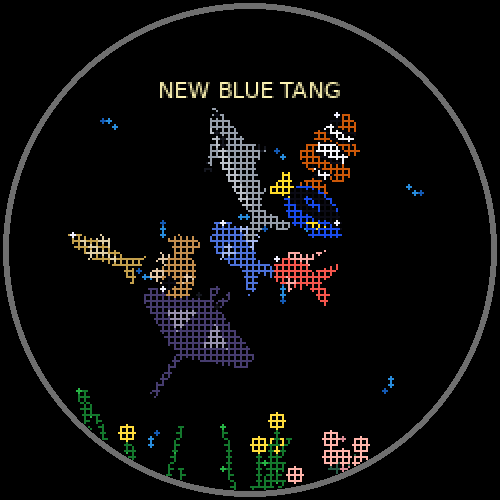
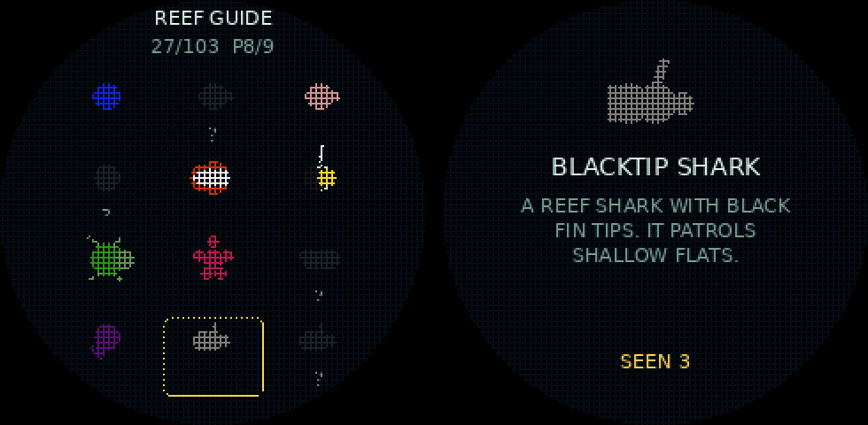
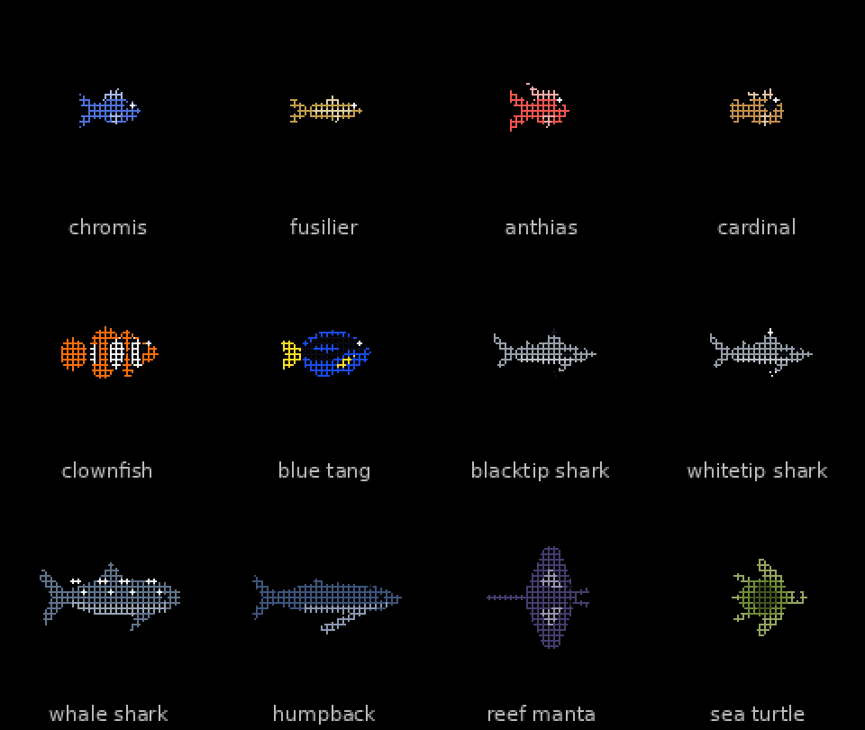

# Aquarium

A little pixel aquarium for the Garmin fenix 7S. It is a Connect IQ port of
[francistse/esp32-cyd-aquarium](https://github.com/francistse/esp32-cyd-aquarium),
the desk aquarium for the ESP32 Cheap Yellow Display, which is itself adapted
from [Livegrid OpenMatrix](https://github.com/livegrid/OpenMatrix). The tank
fills the watch's round screen: reef fish, sharks, a whale shark, a manta, a
humpback, a turtle, drifting chromis, swaying kelp and an anemone, and food
flakes that the fish chase. A Reef Guide records the species you have seen.
It runs on the watch alone; no phone or network is needed.

  

The pictures on this page are not taken from the watch. They are drawn by a
Python copy of the app's drawing code, and the animation runs a Python copy
of the app's swimming, feeding and flocking rules at about the frame rate
measured on the watch (`docs/readme_art.py` makes them). The shapes and
movement match the app; the colours are shown at full depth where the watch
has 64, and the text is in a stand-in font.

## Requirements

- A Garmin fenix 7S. The manifest lists only the 7S, and the layout is
  written for its 240 x 240 round screen. Other watches are untested.
- To build it yourself: VS Code with Garmin's Monkey C extension and the
  Connect IQ SDK. To install a prebuilt `.prg`: a way to copy files to the
  watch over MTP (on a Mac, [OpenMTP](https://openmtp.ganeshrvel.com); the
  watch does not appear in Finder).

## Installing

### From a release

1. Download the `.prg` from the Releases page.
2. Quit Garmin Express completely, connect the watch by cable, and open
   `GARMIN/APPS` on the watch in OpenMTP.
3. Copy the `.prg` into `GARMIN/APPS` and eject the watch.
4. On the watch, press Start and pick Aquarium from the activity list.

Sideloaded apps vanish from the `APPS` folder listing on the next mount;
that is normal and the app stays installed.

### Building it

1. Install VS Code, a Java runtime (adoptium.net), and the Connect IQ SDK
   Manager from developer.garmin.com/connect-iq/sdk/. In the SDK Manager,
   download the current SDK and the fenix 7S device files.
2. In VS Code, install the "Monkey C" extension by Garmin and run
   "Monkey C: Verify Installation" from the command palette.
3. File > Open Folder on this repository, then "Monkey C: Build for
   Device". The first build generates a developer key; keep it. The build
   may print warnings; it should finish without errors. The `.prg` lands in
   the project folder.
4. Install it as above.

## Using it

Navigation is by the buttons, with one touch gesture.

| Control | Does |
| --- | --- |
| Tap the screen | Drops a food flake from the surface above where you tap. The nearest fish not already chasing food goes after it. |
| Up (middle left) | Shows the diary line for eight seconds: hours since the app was opened, creatures alive, flakes eaten. |
| Start (top right) | Opens the Reef Guide. |
| Down (bottom left) | Shows or hides the frames-per-second figure (shown when the app starts). |
| Back | Leaves the app. |

In the Reef Guide: Up and Down move the highlight, Start or a tap on a cell
opens that species, and a swipe left or right turns the page. Back returns
from a species to the index, and from the index to the tank. The tank pauses
while the guide is open.

The Light key (top left) cannot be read by a watch app, which is why the
diary is on Up.

### The Reef Guide

  

The guide has 103 entries: the 99 swimming species, plus the background
chromis, the anemone, the kelp and the food flake. They are on nine pages in
catalogue order. A species is recorded the first time it appears in your
tank, with a "NEW" bubble; until then it shows as a dark silhouette with a
question mark. The guide is saved on the watch, so it keeps between runs.
A species page shows its name, a short description and how many times it
has appeared.

### Creatures

  

Chromis, fusiliers, anthias and cardinalfish are most of what you will see,
in many species and colours. The reef sharks, the whale shark, the manta,
the humpback and the turtle turn up every so often: about half of tanks
start with one, and after that about one swap in eleven brings one in.

The tank holds eight creatures of different species. Every 20 to 40 minutes
the one that has been there longest is swapped for a weighted random pick of
a species not already in the tank. Fish are fed automatically as well as by
tap. A few minutes after opening, and then about once an hour, a visitor
passes: a cat's paw at the surface, a duck, a diver, or a shadow sweeping
across. The paw and the shadow scatter the fish. On Saturdays and Sundays
the fish school together.

## Settings

Everything tunable is in `source/Cfg.mc`, with a comment on each line:

- `FRAME_MS`: the requested frame period (100 = 10 frames a second). Motion
  per frame is scaled from it. The watch draws more slowly than this, so the
  creatures drift more slowly than on the CYD.
- `NUM_FISH`: creatures in the tank (8).
- `BIG_WEIGHT`: how often the six big species appear (16 gives the figures
  above).
- `OUTLINE_SCALE`: the size of the outline drawings; `CREATURE_SCALE`: the
  size of the silhouettes still drawn the CYD way.

`docs/NOTES.md` has the full account of what was carried over from the CYD
build, what was changed and why.

## How it differs from the CYD aquarium

- The tank is a circle, radius 40 tank units, rather than an 80 x 106
  rectangle, and creatures are steered back from the rim. It holds eight
  creatures rather than twelve.
- Nine silhouettes (the four common fish families, the reef sharks, the
  whale shark, humpback, manta and turtle) are drawn as fish outlines
  instead of the CYD's circle-based shapes, which read as blobs at watch
  size. The other species keep the CYD drawings.
- The big species are weighted up so they are seen.
- Steering uses a per-creature random walk instead of OpenSimplex noise; the
  water is plain black instead of the CYD's moving shimmer; there are fewer
  background chromis.
- No tank camera or zoom, no poke, no clock overlay, no Wi-Fi or sensors.
  Species are recorded when they appear rather than by zooming in on them.

## Status

Tested on a fenix 7S. With `FRAME_MS` at 100 an early build drew about 3
frames a second on the watch, which looks fine. Memory use has not been
measured (the SDK allows a watch app on the 7S 768 KB). Other watches are
untested.

## Credits

- [francistse](https://github.com/francistse/esp32-cyd-aquarium) for the
  CYD aquarium this is translated from, including the reef species roster,
  the Reef Guide and the large fauna.
- [Lagerpun](https://github.com/Lagerpun/esp32-cyd-aquarium) for the
  original Cheap Yellow Display port.
- [Livegrid](https://github.com/livegrid/OpenMatrix) for the OpenMatrix
  aquarium it all descends from.
- FastLED's `hsv2rgb_rainbow` (as shipped in
  [GFX_Lite](https://github.com/drvkmr/GFX_Lite)) for the colour conversion.

## Licence

GNU Affero General Public License v3.0, because the CYD aquarium this is
translated from, and the OpenMatrix project that is based on, are AGPL-3.0.
See `LICENSE` for the licence and `NOTICE` for the lineage and what was
modified. In short: you may use, change and share it, provided anything you
share carries the same licence, its source is available, and the notices
stay with it.
